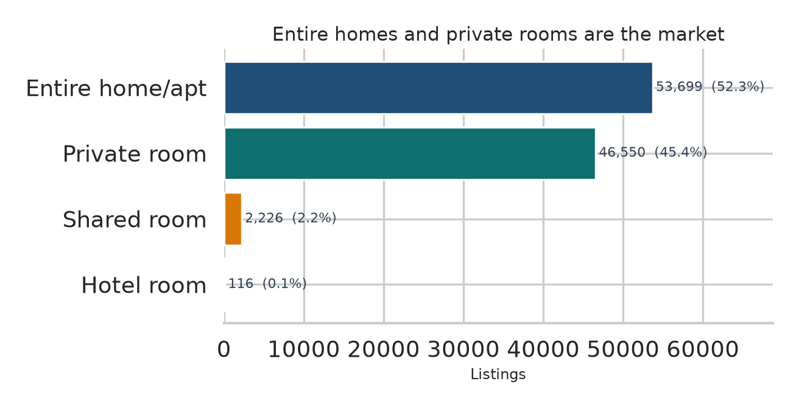
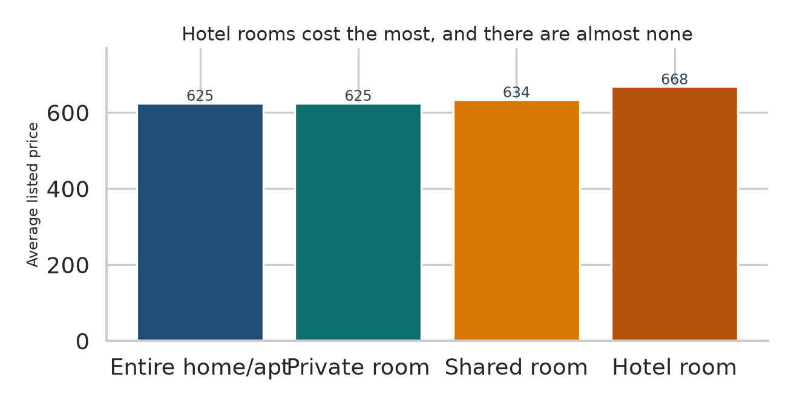
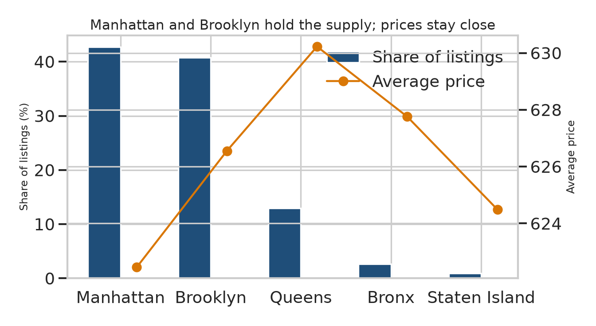
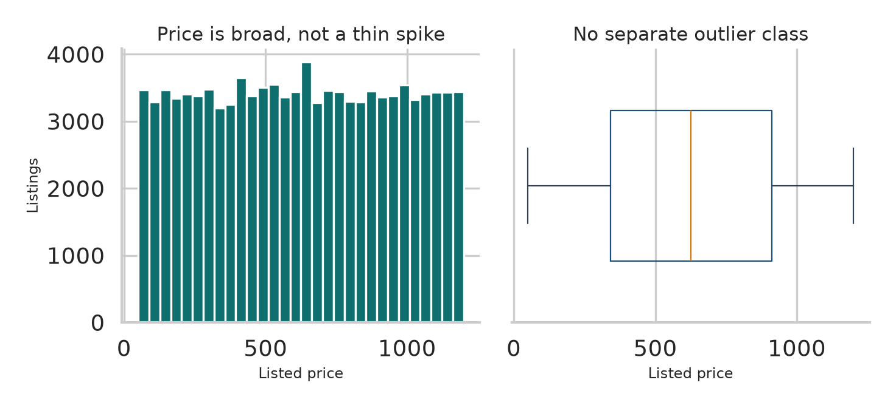
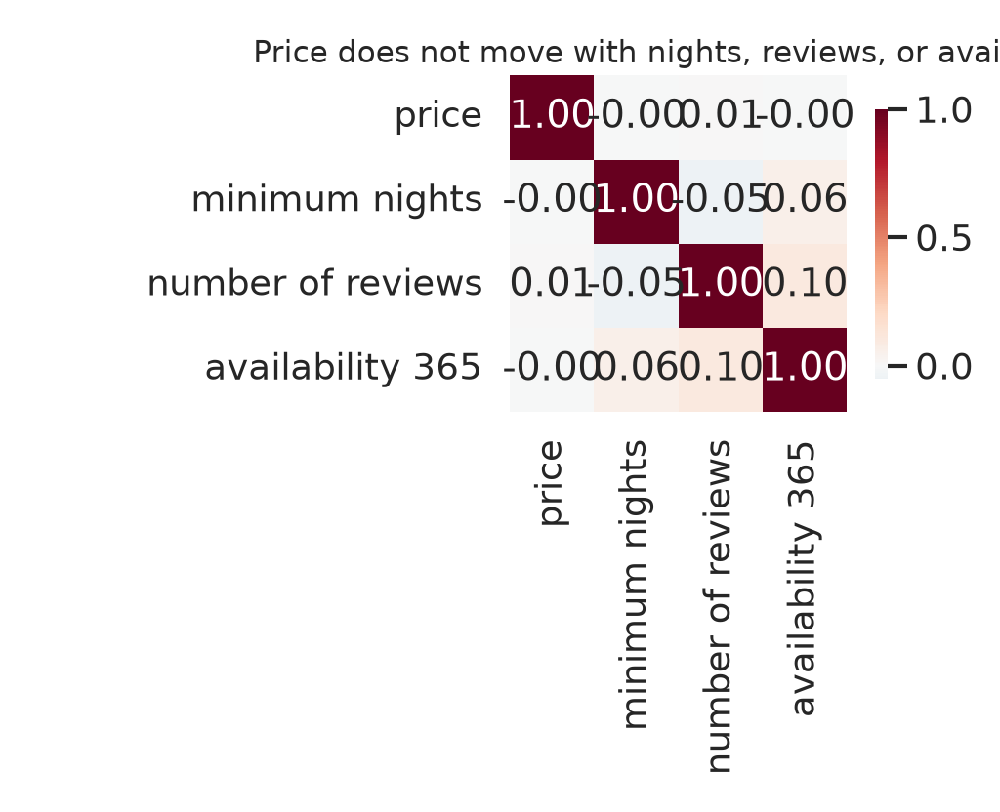
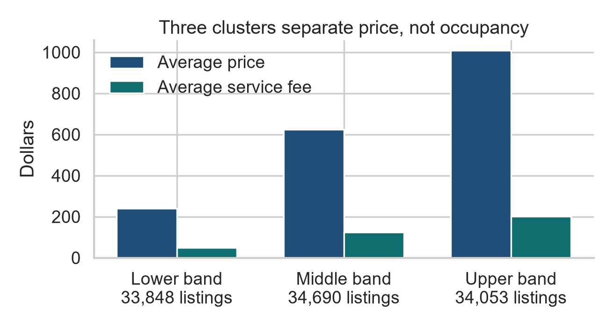

# Analysis

NYC Airbnb listings, DS 514 Data Mining. About 102,600 rows after dropping records with no coordinates. The question is where supply sits, what drives price, and whether clustering finds segments a business can act on.

## 1. Two room types are the market

| Room type | Listings | Share |
| --- | ---: | ---: |
| Entire home/apt | 53,699 | 52.3% |
| Private room | 46,550 | 45.4% |
| Shared room | 2,226 | 2.2% |
| Hotel room | 116 | 0.1% |

Entire homes and private rooms are 97.7% of inventory. Shared rooms are a side market. Hotel rooms are a trace.

## 2. The rare room type is the expensive one

| Room type | Average price | Average minimum nights |
| --- | ---: | ---: |
| Hotel room | 668 | 4.1 |
| Shared room | 634 | 6.6 |
| Entire home/apt | 625 | 9.8 |
| Private room | 625 | 6.3 |

Hotel rooms lead on price and ask for the shortest stay. Entire homes and private rooms are the same price, about 625. Entire homes ask for the longest stay, almost 10 nights. The course note that entire homes price below private rooms does not hold in this file: the two averages differ by five cents.

## 3. Supply is concentrated. Borough prices are not.

| Borough | Share of listings | Average price |
| --- | ---: | ---: |
| Manhattan | 42.7% | 622 |
| Brooklyn | 40.8% | 627 |
| Queens | 12.9% | 630 |
| Bronx | 2.6% | 628 |
| Staten Island | 0.9% | 624 |

Manhattan and Brooklyn are 83.5% of listings. That is the concentration the report flags as a structural feature of Airbnb in New York.

Borough average prices only span 622 to 630. Queens is slightly highest. Manhattan is slightly lowest. A raw label, `The Bronx`, can print near 909 because it is a handful of rows, not the Bronx. After those labels are folded into the five boroughs, no borough is a luxury market on its own.

The price gaps that matter are inside Manhattan and Brooklyn, not between borough averages.

## 4. Price is wide, and it does not follow the other listing fields

Mean and median price are both about 625. The histogram is broad. The box plot does not show a detached outlier class, which matches the report. A single mean is a fair summary of the center, and a poor summary of the spread.

|  | Price | Minimum nights | Reviews | Availability |
| --- | ---: | ---: | ---: | ---: |
| Price | 1.00 | 0.00 | 0.01 | 0.00 |
| Minimum nights | 0.00 | 1.00 | −0.05 | 0.06 |
| Reviews | 0.01 | −0.05 | 1.00 | 0.10 |
| Availability | 0.00 | 0.06 | 0.10 | 1.00 |

Price is uncorrelated with minimum nights, review count, and availability. Those fields do not explain why one listing costs more than another. Location and the price itself have to carry the segmentation.

## 5. Three clusters are price bands

K-means on price, service fee, minimum nights, number of reviews, latitude, and longitude. The elbow method in the study selects **K = 3**. A refit with `random_state=0` returns a silhouette score of about **0.55**, the same level reported in the course write-up.

| Band | Listings | Average price | Price range | Average service fee | Availability (days) | Reviews per month | Typical neighbourhood |
| --- | ---: | ---: | --- | ---: | ---: | ---: | --- |
| Lower | 33,848 | 241 | 50–432 | 48 | 141 | 1.15 | Bedford-Stuyvesant |
| Middle | 34,690 | 623 | 429–823 | 125 | 140 | 1.17 | Bedford-Stuyvesant |
| Upper | 34,053 | 1,009 | 817–1,200 | 202 | 140 | 1.17 | Williamsburg |

The three bands are almost equal in size. Service fees scale with price (about 20% of the average price in each band). Availability and reviews do not. Guests are not more active in the expensive band. The clusters are a pricing ladder sitting on the same two neighbourhoods and the same two boroughs.

Brooklyn and Manhattan hold both the floor and the ceiling. The upper band reaches 1,200. The lower band starts at 50. That is the report's finding in operational form: the highest and lowest prices are a Manhattan–Brooklyn pattern, not a outer-borough pattern.

## 6. What to do with it

The report's recommendation follows from the charts above.

1. **Add supply where the upper band already exists.** Williamsburg, Bedford-Stuyvesant, and the Manhattan neighbourhoods that post the top prices (Harlem, the Financial District, the Upper West Side in the original cluster tables). Borough averages will not move. Local scarcity inside these neighbourhoods is what the upper band is measuring.
2. **Grow entire homes and private rooms.** They are 98% of volume and priced together near 625. Hotel rooms are a 116-listing luxury tail, not a growth plan.
3. **Do not rank boroughs by average price.** After label cleanup, Queens, the Bronx, Brooklyn, Staten Island, and Manhattan sit within 8 dollars. Treat Queens, the Bronx, and Staten Island as coverage, not as the first place to chase a premium.
4. **Price from the band, not from reviews or availability.** Those two measures are flat across clusters. A host tool that sorts "high demand" by reviews will not recover these segments.
5. **Keep K = 3, and re-fit when the extract changes.** The silhouette of 0.55 is moderate. It is strong enough for this segmentation and too weak to freeze into an automated pricing rule without a fresh check.

## Scope

One snapshot. Filling missing prices with the mean pulls some rows toward 625, so the middle band is slightly thicker than a complete-case run would be. Neighbourhood names still contain a few geocoder labels. Nothing here measures what happens to price after new listings are added. The association is the decision basis the report uses, not a controlled test.
